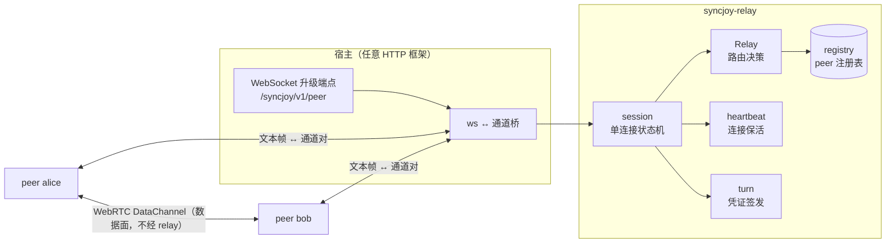
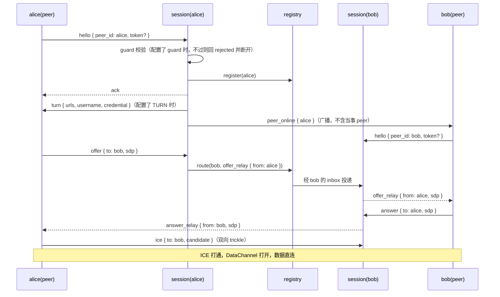
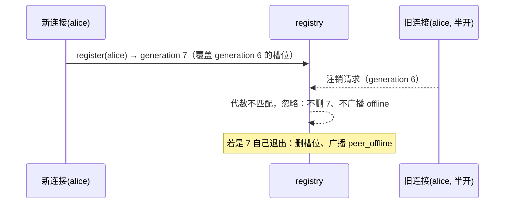

# syncjoy-relay

零框架依赖的信令核心：peer 注册表、SDP/ICE 路由、上下线广播、心跳保活、TURN 凭证签发、可选的注册准入 guard。不绑定任何 HTTP 库，宿主自选框架收 WebSocket，经一对通道把连接交给 `session::run`。数据面在 peer 之间 WebRTC 直连，relay 不转发应用数据。

使用方式与宿主接线见 [docs/relay-sdk.md](../../docs/relay-sdk.md)。

<a id="anatomy"></a>
# 组成与数据流

五个模块，宿主只接触 `session`：



`session::run(relay, inbound, outbound)` 是唯一集成入口：inbound 收到对端文本帧就送入，outbound 收到 relay 文本帧就写回 WebSocket。每个连接一个 session，session 之间经 registry 转交消息。

<a id="signaling"></a>
# 信令时序



<a id="messages"></a>
# 消息行为表

| 来向 | 消息 | relay 行为 |
|---|---|---|
| peer | `hello` | 配置 guard 时先校验准入，不过则回 `rejected { reason: registration denied }` 并断开；通过则注册（同 id 顶替旧连接），回 `ack`；配置 TURN 时追加凭证；广播 `peer_online` |
| peer | `offer` | 按 `to` 点对点路由为 `offer_relay`；目标不在线回 `rejected { to }` |
| peer | `answer` / `ice` | 按 `to` 路由为 `*_relay`；目标不在线静默丢弃（协商自然超时） |
| peer | `decline` | 按 `to` 路由回 `rejected { to: 拒绝方, reason: declined by peer }`，发起方拨号立即失败 |
| relay | `ping` | 定时发给每个已注册 peer（默认间隔 30s）；超时未回 `pong` 视为半开，断开并走注销、广播 `peer_offline` |
| peer | `pong` | 刷新心跳计时 |
| 连接 | 断开 | 注销（代数校验），广播 `peer_offline`；对端据此拆直连 |

<a id="takeover"></a>
# 同 id 顶替的代数护栏

同一 peer id 重复注册是自愈手段（半开连接恢复），registry 用代数（generation）保证顶替与退出互不误删：



半开连接由心跳踢除，间隔与超时经 `Relay::with_heartbeat(HeartbeatConfig)` 调整；历史问题与 open questions 见 [issues/ghost-session-keepalive.md](../../issues/ghost-session-keepalive.md)。

<a id="guard"></a>
# 注册准入

冒充任意 peer_id 发 hello 即可顶替旧连接，需要收紧的宿主用 `Relay::with_guard` 注入准入回调：每个 hello 先过 guard（入参 peer_id 与 hello 携带的可选 token），返回 false 的连接收到 `rejected { reason: registration denied }` 后被断开，不入注册表、不广播上下线。不配 guard 时所有 hello 放行，行为与从前一致。guard 只回放使用方注入的判断，凭证的签发与验证属使用方职责，宿主接线见 [docs/relay-sdk.md](../../docs/relay-sdk.md#guard)。

<a id="turn"></a>
# TURN 凭证签发

穿透失败的兜底由部署层的 coturn 承担，SDK 只签发 coturn REST 式凭证：`username = "{过期时间戳}:{peer_id}"`，`credential = base64(HMAC-SHA1(secret, username))`，默认 1 小时。配置了 `TurnConfig` 的 relay 在每个 peer 注册成功后下发，peer 自动追加进 ICE 列表。

```rust
use syncjoy_relay::{Relay, TurnConfig};

let relay = Relay::with_turn(TurnConfig {
    urls: vec!["turn:turn.example.com:3478".to_owned()],
    secret: std::env::var("SYNCJOY_TURN_SECRET").unwrap(),
});
```
