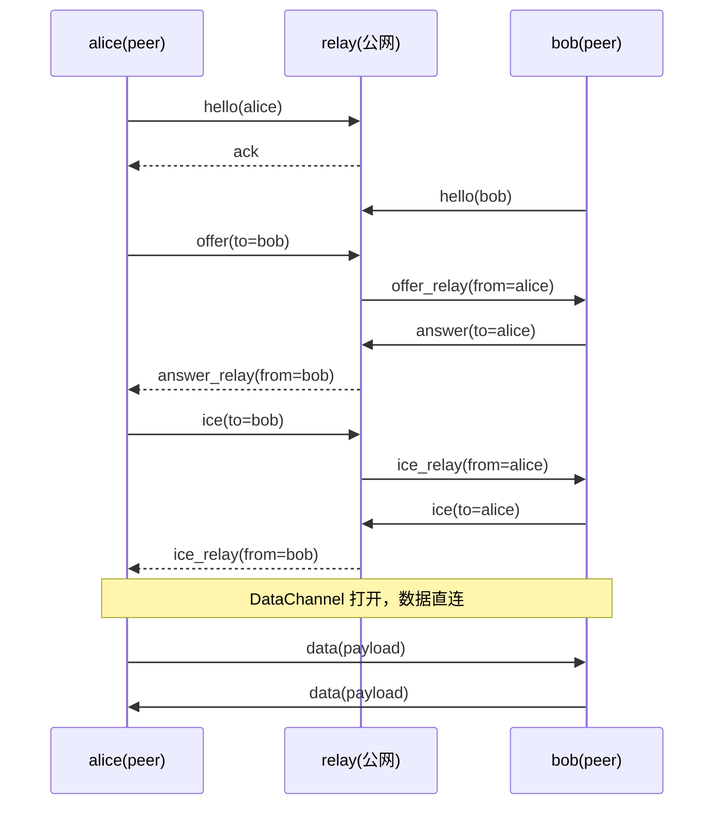

# 对等模型

syncjoy 的连接层没有角色之分：参与方一律是 peer，各自内嵌 `syncjoy-peer`。之前的 daemon/client 划分只反映宿主业务的不同（谁是状态宿主），不反映连接层的差异，已合并为 peer：连接层的行为完全对称，都是出站连 relay、都持有通道、都可主动发起连接。

| 参与方 | SDK | 部署位置 | 持有什么 |
|---|---|---|---|
| relay | `syncjoy-relay` | 公网 | peer 注册表与信令路由，无业务状态 |
| peer | `syncjoy-peer` | 任意位置（状态宿主通常在内网） | 自己的 WebRTC 连接；业务状态归宿主 |

内网 peer 主动出站连接 relay 的信令 WebSocket，因此不需要公网 IP，也不需要开入站端口。数据面是 peer 之间的 WebRTC DataChannel 直连，不经过 relay。

peer 的平台目标是原生（iOS、Android 及一般原生宿主）与浏览器（wasm + JS 绑定）双形态，传输层按 feature 切分。

# 连接策略

当前只有"relay 信令撮合 + WebRTC 直连"一条路：

1. WebRTC 直连：两个 peer 各自出站连 relay 信令，SDP/ICE 经 relay 路由，ICE 打通后 DataChannel 直连（当前唯一实现）；
2. 同内网直连：两个 peer 同内网时跳过公网信令直接发现对方（未实现，见 roadmap）。

NAT 穿透由 ICE 完成：默认携带公共 STUN；relay 配置了 TURN 时向 peer 签发限时凭证（coturn REST 式），穿透失败的兜底路径由 TURN 承担，仍不需要 relay 转发应用数据。

# 消息流

每条 peer 连接的第一帧是 `hello`（只带 peer id，无鉴权），relay 回 `ack`，该 peer 此后可与任意在线 peer 协商直连：

relay 是无头组件，不做任何准入判断：能否通信由使用方决定，鉴权所需的业务上下文只存在于使用方应用里。

# v0 行为边界

以下都是当前实现的既定行为，不是缺陷，变更需走 decisions 留档：

- 来向 offer 默认自动应答；宿主注册 `on_incoming` 后可逐个裁决，拒绝走 `decline` 帧回击发起方（协议 v6）；
- `connect_peer` 指向的 peer 不在线时立即 `rejected`，SDK 层不缓存意图；这也是在线与否的唯一呈现，没有在线广播（决策留档见 [decisions/no-presence-broadcast.md](../decisions/no-presence-broadcast.md)）；
- 同一 peer id 重复注册会顶替旧连接（代数校验保证旧连接退出时不误删新注册），见 [issues/ghost-session-keepalive.md](../issues/ghost-session-keepalive.md)；
- DataChannel 的生死由数据面自身判定，与对端的信令连接无关：对端优雅退出走 SCTP 关闭立即触发 `on_close`，硬死亡由 ICE consent（RFC 7675）约 30 秒内判死；SDK 不做自动重连（重连决策留档见 [decisions/link-close-notify-no-reconnect.md](../decisions/link-close-notify-no-reconnect.md)），重连后需重新协商；
- 每对 peer 之间一条 DataChannel，`connect_peer` 对已连接的 peer 直接返回现有连接的句柄，不重复拨号；
- 连接回收跟随句柄生命周期：末位 `PeerLink` 被 drop 或调用 `close` 即拆除连接（`close_peer(to)` 可无句柄拆除），`on_close` 回调感知关闭且至多触发一次；
- 消息内容对 syncjoy 不透明：DataChannel 载荷是原始字节，编码由使用方自行解析；信令面保持带版本号的 JSON 文本帧。
